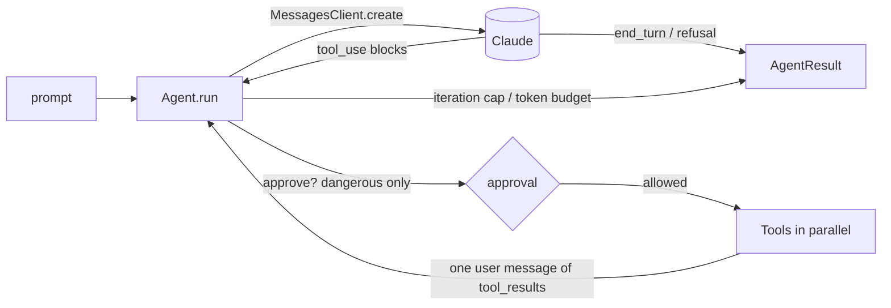

# llm-agent-toolkit

A minimal, framework-free agent runtime for Claude: typed tools, parallel calls, budgets and approvals.

[](https://github.com/Muhaman/llm-agent-toolkit/actions/workflows/ci.yml)

## What it does

- Defines tools with a zod schema (`defineTool`); the JSON Schema is derived with `z.toJSONSchema` and sent with `strict: true`.
- Runs the tool-use loop against the Messages API: appends the full assistant content, executes all `tool_use` blocks concurrently, and returns every `tool_result` in one user message.
- Turns invalid input and thrown errors into `is_error` tool results so the model can recover.
- Enforces an iteration cap and a total output-token budget, reports usage and USD cost, and gates `dangerous` tools behind an `approve` callback.
- Ships four sample tools (`calculator`, `http_get`, `read_file`, `now`) and an `agent "<question>"` CLI.

## Architecture



`Agent` depends only on the `MessagesClient` interface, so tests use a scripted fake and production uses the Anthropic SDK.

## Quickstart

```bash
npm install
export ANTHROPIC_API_KEY=...
export AGENT_ALLOWED_HOSTS=example.com   # hosts http_get may call
npm run build
npx agent "What is 2^3^2, and what time is it?"
```

`ANTHROPIC_MODEL` overrides the default `claude-opus-5-5`; `AGENT_ROOT_DIR` sets the `read_file` sandbox (default: cwd).

## Usage

```ts
import Anthropic from "@anthropic-ai/sdk";
import { z } from "zod";
import { Agent, calculatorTool, defineTool, withRefusalFallback } from "llm-agent-toolkit";

const shout = defineTool({
  name: "shout",
  description: "Upper-case a string.",
  input: z.object({ value: z.string() }),
  run: async ({ value }) => value.toUpperCase(),
});

const agent = new Agent({
  client: withRefusalFallback(new Anthropic()),
  tools: [calculatorTool, shout],
  maxIterations: 10,
  maxOutputTokens: 50_000,
  approve: async ({ name, input }) => askHuman(name, input), // only called for dangerous tools
});

const { text, stopReason, usage } = await agent.run("What is (17 + 5) * 3?");
```

`stopReason` is one of `end_turn`, `max_iterations`, `budget`, `refusal`. See `examples/basic.ts`.

## Design decisions & trade-offs

- **Own loop instead of the SDK tool runner.** Per-call approval, event hooks, an exact iteration cap and a token budget are first-class, and the loop runs against a one-method interface that is trivial to fake. Cost: ~100 lines to maintain.
- **Errors go back to the model.** Validation failures, thrown errors, unknown tools and denials become `is_error` results; the loop only throws for transport errors and truncated (`max_tokens`) responses.
- **Safe by construction tools.** The calculator is a recursive-descent parser (no `eval`); `http_get` checks an exact-host allowlist, refuses redirects and times out after 5 s; `read_file` resolves symlinks before checking the sandbox root.
- **Refusal fallback lives in an adapter.** `withRefusalFallback` sends the beta `server-side-fallback-2026-07-01` with `fallbacks: "default"` via the beta endpoint, keeping `Agent` on the plain non-beta types. Use your own `MessagesClient` to opt out.
- **Cost is a local estimate** from a small per-model price table (default `claude-opus-5-5`, $4/$20 per MTok); cached-token discounts are not modelled.

## Testing

```bash
npm run lint && npm run typecheck && npm test
```

Agent tests drive a scripted fake client (round trip, parallel calls, errors, invalid input, iteration cap, budget, approval, refusal, usage and cost); tool tests cover the calculator grammar, host allowlist and sandbox escapes. CI runs the same commands plus a build.

## Limitations & next steps

- Non-streaming requests only; no streaming events or cancellation of in-flight tool calls beyond the abort signal.
- No prompt caching, conversation persistence or multi-turn `run` (each call starts fresh).
- The budget counts output tokens only and is checked after each response, so it can overshoot by one turn.

## License

MIT
